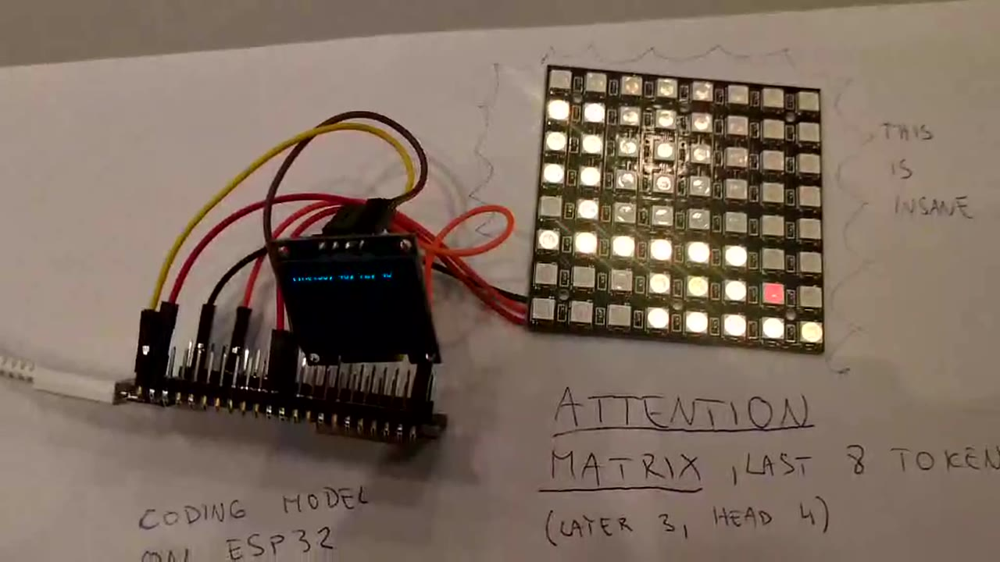

# Hold attention in your hand



Everybody draws attention as a heatmap. I wanted one I could pick up.

A 4-million-parameter language model runs on an ESP32-S3 and writes small programs. While it writes, 64 LEDs show
one of its attention heads, live: which earlier tokens the model is looking at for the token it is writing now.
No laptop in the loop. The whole thing fits in a palm.

(Strictly: you hold what one head is paying attention to. The head itself is 0.6 % of the weights and stays in the flash.)

## How to read the square

- A **row** is a token that looks. The newest token is the row next to the wires.
- A **column** is a token it looks at. Only the last 8 tokens fit.
- **Brighter** is more attention. Each row has the same amount to give away.
- Half the square stays **dark**. That is the future. A token cannot look at what has not been written yet,
  and you can see that it does not.

## What a head is, in three sentences

To write the next token, the model looks back at what it has written, and an attention head is one way of looking:
it gives every earlier token a share of its attention, and the shares add up to one. This model has 6 layers with
6 heads each, so 36 of them look at once, each at something else. The square shows one; the BOOT button shows the next.

## Build it

**Parts**

| | |
|---|---|
| ESP32-S3 board with 16 MB flash and 8 MB PSRAM (N16R8) | the model lives in the flash |
| 8x8 WS2812B LED square | "64 RGB LEDs, only ONE pin", it says on the back |
| 0.96" I2C OLED, 128x64 | optional: the text being written, and which head you are holding |
| three wires and a soldering iron | the square comes without pins |

**Wires**

| from | to |
|---|---|
| square `V+` | `5V` |
| square `V-` | `GND` |
| square `IN` | pin `21` |
| screen `VCC`, `GND` | `3V3`, `GND` |
| screen `SDA`, `SCL` | pins `18`, `8` |

The square has two sets of pads. Solder to `IN`. `OUT` is where the data leaves.

**Flash**

```
arduino-cli core install esp32:esp32
arduino-cli lib install "Adafruit SSD1306" "Adafruit GFX Library"
./flash.sh                # the model, then the program; add the port if it is not /dev/ttyACM0
```

It starts writing by itself. To check the wiring first, `python talk.py` and type `@tri`: a red triangle with a
white diagonal and one green corner, standing still. If it is in the wrong half, turn the square, or set
`LEDS_FLIP_X` in `firmware/attention/leds.h`.

**Use**

| | |
|---|---|
| BOOT button | the next head |
| `@head 3 4` | layer 3, head 4 (both count from 0) |
| any other line | a request for the model: `draw a house` |

## Another model

Any model that already runs on this chip with [slvDev/esp32-ai](https://github.com/slvDev/esp32-ai)'s runtime plugs in:

```
MODEL=path/to/folder REQUESTS="The temperature of a body is|Heat is" ./flash.sh
```

The folder holds `model.bin` and `tokenizer.json`. Tried with one other model, the one from
[maxwell-on-a-chip](https://github.com/moudrkat/maxwell-on-a-chip): it wrote about heat at 4.6 tokens a second.
Which of its heads is worth holding, I have not looked. Press BOOT.

## How it works

- For every token and every head, the runtime computes a row of weights, uses it, and throws it away.
  `runtime/attention.h` keeps the row of one head. The last 8 rows are the square.
- `firmware/attention/leds.h` draws it. This is the fourth LED driver. The first three were perfect on a picture
  that stands still and fell apart when the model started writing: rows of full white, random colours. The LEDs
  want pulses of 0.3 and 0.9 millionths of a second, and a chip busy with a language model is late for some of them.

## Small print

- The head shown at start is layer 3, head 4. I measured all 36 on the chip over 250 tokens: this one keeps 91 %
  of its weight inside the last 8 tokens and its row changes most from token to token. Most of the others look
  mostly further back than the square reaches, and would show a few faint dots.
- I know where this head looks (2 to 4 tokens back, mostly). I do not know what it is for.
- A faint cell comes out red instead of orange: at that brightness the green part rounds down to nothing.
- About 4 tokens a second.
- Built and run on one board, in one day. If your square shows something else, I would like to see it.

## Thanks

The runtime that puts a language model on this chip is Viacheslav Sierbov's
[slvDev/esp32-ai](https://github.com/slvDev/esp32-ai). See `THIRD_PARTY.md`.

More of this, and what I would like to hear from you: [tell-me](https://github.com/moudrkat/tell-me).
